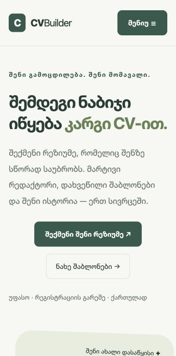

# CVBuilder

რეზიუმეს ონლაინ კონსტრუქტორი ქართულად. შეავსე ინფორმაცია, აირჩიე შაბლონი და შეინახე რეზიუმე PDF-ად.

**[საიტის ნახვა →](https://lapetitenea.github.io/cvbuilder/)**

## ეკრანის სურათი

მთავარი გვერდი მობილურზე:



## ფუნქციები

- ფორმის შევსებისას რეზიუმეს პრევიუ მაშინვე ახლდება.
- გამოცდილების, განათლებისა და უნარების დამატება და წაშლა.
- სექციების თანმიმდევრობის შეცვლა.
- ექვსი შაბლონი და აქცენტის ფერის არჩევა; დამატებითი შაბლონები გასაშლელ ბლოკში.
- ფოტოს ატვირთვა, შემცირება და CV-სთან ერთად შენახვა.
- მსუბუქი ანიმაციები მოძრაობის შემცირების პარამეტრის გათვალისწინებით.
- სახელის, ელფოსტისა და ტელეფონის ვალიდაცია.
- რამდენიმე რეზიუმეს შენახვა, ძიება და რედაქტირება.
- ბეჭდვა და PDF-ად შენახვა ბრაუზერიდან.
- მონახაზის ავტომატური შენახვა და აღდგენის შეთავაზება.
- CV-ის JSON ფაილად ექსპორტი/იმპორტი და შევსების პროგრესი.
- მობილურზე მორგებული გვერდები და მენიუ.

## ტექნოლოგიები

HTML5, CSS3 და JavaScript (ES modules). მონაცემები ინახება localStorage-ში. საიტი გამოქვეყნებულია GitHub Pages-ზე.

## ლოკალურად გაშვება

```sh
git clone https://github.com/lapetiteNea/cvbuilder.git
cd cvbuilder
python3 -m http.server 8000
```

გახსენი [localhost:8000](http://localhost:8000/). ასევე შეგიძლია VS Code-ში `index.html` გაუშვა Live Server-ით. JavaScript მოდულების გამო პროექტი ადგილობრივი სერვერით უნდა გაიხსნას.

დამოკიდებულებების ინსტალაცია და აწყობა საჭირო არ არის.

## გამოყენება

1. გახსენი რედაქტორი და შეავსე პირადი ინფორმაცია.
2. დაამატე სასურველი სექციები, აირჩიე შაბლონი და ფერი.
3. დააჭირე „შენახვა“. შენახული ვერსიები გამოჩნდება „ჩემი რეზიუმეების“ გვერდზე.
4. PDF-ისთვის დააჭირე „ბეჭდვა / PDF“, აირჩიე Save as PDF და A4. გამორთე ბრაუზერის Headers and footers.

რეზიუმეები ინახება მხოლოდ იმ ბრაუზერში, რომელშიც მუშაობ. სხვა მოწყობილობაზე ავტომატურად არ გადადის და ბრაუზერის მონაცემების გასუფთავებისას შეიძლება წაიშალოს. მონახაზი ავტომატურად ინახება და დაბრუნებისას აღდგენა შეგიძლია. „ჩემი რეზიუმეების“ სიაში საბოლოო ვერსიის დასამატებლად დააჭირე „შენახვას“. JSON ფაილის დახმარებით რეზიუმეს სხვა მოწყობილობაზე გახსნი.

ფოტოსთვის გამოიყენე JPG, PNG ან WebP (8 MB-მდე). ფოტო ბრაუზერშივე მცირდება მაქსიმუმ 480 პიქსელამდე და რეზიუმესთან ერთად ინახება.

კონტაქტის ფორმა დემოა: ამოწმებს ველებს, მაგრამ შეტყობინებას არ აგზავნის.

## ფაილები

- `index.html` — მთავარი გვერდი.
- `pages/` — რედაქტორი, შაბლონები, შენახული რეზიუმეები, რჩევები და კონტაქტი.
- `css/` — საერთო სტილები, განლაგება, კომპონენტები, შაბლონები და ბეჭდვა.
- `js/` — რედაქტორი, მონაცემების დამუშავება, პრევიუ და შენახვა.
- `assets/screenshots/` — README-ის ეკრანის სურათი.
- `tests/` — ლოგიკისა და ბმულების შემოწმება.

## შემოწმება

ტესტებისთვის საჭიროა Node.js 22+ და Python 3:

```sh
node --test tests/*.test.mjs
python3 tests/check_links.py
```

ავტომატური ტესტები ამოწმებს ვალიდაციას, სექციების რიგს, შენახვას, განახლებას, წაშლას, ფოტოებსა და შენახვის შეცდომებს. მეორე ბრძანება ამოწმებს HTML ბმულებსა და რესურსებს. ეს შემოწმებები GitHub Actions-შიც ეშვება.

## ავტორი

ნინო შარაშიძე
